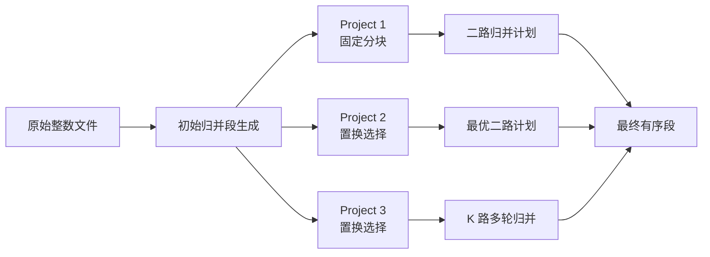

# 外存排序 | External Memory Sorting

一个用 C++11 实现的外部排序课程项目，演示当输入数据超过排序工作区容量时，如何借助磁盘归并段、块缓冲和多路归并完成排序。

项目从 Week 3 到 Week 8 逐步演进，包含三个相互复用的排序方案。它适合作为外存算法、C++ 文件 I/O、算法工程化和测试实践的学习作品。

## 项目内容

| 方案 | 初始归并段 | 归并方法 | 关注点 |
|---|---|---|---|
| Project 1 | 固定容量分块内排 | 普通二叉计划与二路归并 | 文件组织、块读写、归并树 |
| Project 2 | 败者树置换选择 | 哈夫曼最优二路计划 | 冻结/解冻、双缓冲、分阶段三线程 |
| Project 3 | 置换选择 | 败者树 K 路归并及多轮主控 | 共享 `2k` 输入块、预取调度、块回收 |

三种方案共用段文件和基础 I/O 结构。文件由固定文件头、预留目录和顺序数据区组成；目录记录各段的名称、起始字节偏移和元素数量。输入、输出按块操作，算法按整数消费数据。



## 构建与运行

### Windows 原生 MSVC

准备 Visual Studio Build Tools 的 MSVC C++ x64/x86 工具和 Windows SDK，以及 CMake 3.21 或更新版本。完整 Visual Studio IDE 不是必需项。

在仓库根目录 PowerShell 运行：

```powershell
.\验收.ps1 week3
.\验收.ps1 project1
.\验收.ps1 project2
.\验收.ps1 project3 -K 3
.\验收.ps1 test
.\验收.ps1 ctest
```

脚本会自动配置并增量构建。完整验收（含 `k=2/3/4`、`N=50003`、Benchmark 和 CTest）：

```powershell
.\验收.ps1 all
```

Release 性能测量：

```powershell
.\验收.ps1 benchmark -Configuration Release
```

Windows 安装、VS Code 运行与调试步骤见[环境与验收指南](docs/Windows环境与验收指南.md)。

### Linux / WSL

需要 C++11 编译器和 CMake：

```sh
cmake -S . -B build-linux -DCMAKE_BUILD_TYPE=Release
cmake --build build-linux -j 4
ctest --test-dir build-linux --output-on-failure

cd build-linux
./external_sort week3
./external_sort project1
./external_sort project2
./external_sort project3 --k 3
./external_sort test
./external_sort benchmark
```

## 测试与实测

自动测试覆盖文件与缓冲区机制、边界组合，以及 220 组输入与 `std::sort` 的完整结果逐项比较。CMake 注册了 6 项 CTest，包含正确性、命令行帮助和非法参数检查。

保存的 Windows Release 单次测量中，`N=50003, M=256, B=64, k=4` 时：

| 方案 | 初始段数 | 归并次数 | 数据块读写调用合计 | 用时 |
|---|---:|---:|---:|---:|
| Project 1 | 196 | 195 | 13,964 | 57.579 ms |
| Project 2 | 99 | 98 | 12,258 | 160.114 ms |
| Project 3 | 99 | 34 | 7,970 | 919.600 ms |

数据块计数是程序层面的非空块读写调用，不等同物理磁盘 I/O。用时为单次测量，不是多轮平均或受控冷缓存结果。在这组小块、可缓存的实验中，K 路归并减少了块调用，但 Project 3 因大量阶段线程创建和同步而更慢；项目不宣称线程版本必然加速。报告中分别列出 Windows 和 WSL 数据及实验边界。

## 课程报告

[打开完整实验报告 PDF](report/外存排序课程实践实验报告_刘酝潇_09024211.pdf)。报告共 65 页，依次包含需求分析、系统结构、功能模块设计、测试分析、实验总结和完整源码。

报告的 LaTeX 源码、真实运行截图、矢量图表、CSV、自动生成源码附录的脚本以及编译说明位于 [`report/`](report/README.md)。报告中的代码附录固定对应已记录的提交 `478a7ec`，可以独立复现；仓库后续提交在此基础上继续补充了源码讲解注释。

## 源码结构

```text
main.cpp               命令行入口、模式分派和结果验证
src/run_file.*         二进制文件、归并段目录和块读写
src/buffer.*           输入与输出缓冲
src/merge_plan.*       二路归并计划与执行
src/loser_tree.*       败者树
src/replacement.*      置换选择和分阶段双缓冲
src/kway_merge.*       K 路归并与共享缓冲池
src/projects.*         三个 Project 的统一入口
tests/test_sort.*      机制测试、正确性测试和 Benchmark
```

## 项目文档

- [从零看懂整个项目](docs/从零看懂整个项目.md)：算法介绍和源码阅读路线。
- [验收演示与问答](docs/验收演示与问答.md)：项目演示要点。
- [实验结果与总结](docs/实验结果与总结.md)：数据、指标口径及局限。
- [课程要求与实现对应](docs/课程要求与实现对应.md)：课程需求与实现取舍。
- [Windows 环境与验收指南](docs/Windows环境与验收指南.md)：MSVC、VS Code 与排错。

## 实现范围

这是面向课程项目的实现：使用本机字节序保存 `int32_t` 数据，保留文件内的初始和中间段，并以固定容量目录管理段。实验完成了普通电脑规模的功能验证，没有宣称完成超大规模磁盘压力测试、崩溃恢复或通用跨平台二进制序列化。

## 许可证

本项目使用 [MIT License](LICENSE)。课程材料不包含在代码仓库中；讲义仅用于说明本项目的课程背景和设计依据。
