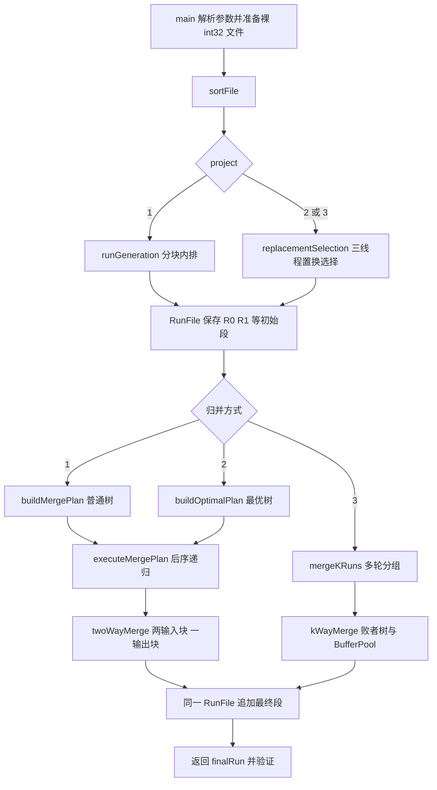

# 从零看懂整个项目

这份讲义按照最终源码解释。建议边读边打开源文件，不必一次记住全部代码。第一次先跑 15 个数的演示；第二次手算同样的数据；第三次修改 M、B、k，预测结果后再运行。真正理解的标准是：能指出一个值现在属于哪个文件、哪个段、哪个块，由哪个线程负责，下一步如何移动。

## 第一章：项目究竟解决什么问题

### 1.1 为什么不能把所有数据直接 sort

内排序假设全部数据可以放进内存。外排序面对的数据可能大于用于排序的内存，需要从文件中分批读入。CPU 只能比较内存中的数，所以问题不是怎样绕过内存，而是怎样在有限的内存里安排读、算、写。

我们用 `int32_t` 保存一个整数，常见平台占 4 字节。原始文件没有空格和换行。例如 `[9,1,8]` 的数据就是连续 12 字节。`read/write` 按字节搬运，`seekg/seekp` 按文件字节位置定位。

算法先生成若干个各自有序的连续片段，叫**归并段**。每段内部有序，不代表所有段拼在一起已经有序。随后把这些段归并，最后得到一个完整有序段。

### 1.2 七个概念分别做什么

| 概念 | 本项目中的具体含义 |
|---|---|
| 二进制文件 | 用 `fstream` 保存固定大小头部、目录、整数，不靠文本分隔符 |
| 归并段 | `RunInfo` 描述的一段连续整数，有名称、起始 offset、元素 count |
| 缓冲区 | 长度 B 的数组，磁盘按块读写，算法逐个取/放 |
| 归并计划树 | `MergeNode` 的数组，叶子对应现有段，内部节点对应一次二路归并 |
| 置换选择 | 固定 M 个候选，每输出一个就尝试补进一个；能接上当前段就继续，否则冻结 |
| 败者树 | 每个内部节点记录比赛败者，总冠军另存，替换冠军后沿路径重赛 |
| K 路归并 | 同时比较至多 k 路当前头值，每次输出最小的一个 |

缓冲与缓存的区别：缓存强调留下旧数据供再次使用；这里的缓冲强调磁盘批量传输与 CPU 逐元素处理之间的衔接。读取后消费一次的块就可以回收，没有必要实现复杂缓存替换或脏块管理。

### 1.3 三个 Project 的关系

Project 1 先做最直观的流程。每次读 M 个数，调用 `std::sort` 排好，再以 B 为单位写出。然后构造普通二叉计划，递归执行归并。

Project 2 改善的是初始段生成。用置换选择把输入中还能接在当前输出后面的数留下来，常能生成超过 M 的长段。得到的段长不相等，因此采用哈夫曼方法选择归并顺序。并行发生在**置换选择阶段**，后面的二路归并仍是串行的。

Project 3 复用 Project 2 的初始段生成，但归并阶段改成真正的多路选择与动态缓冲。它没有把多次二路归并改个名字，而是用一棵以各路头值为叶子的败者树同时选择。

## 第二章：整体架构和数据流



以 `external_sort project2` 为例：

1. `main` 生成固定的 15 个整数，`writeRaw` 写成 `project2_input.bin`。
2. `sortFile(2, ..., 4, 3, 3, &cout)` 先用 `RawInput` 得到 N=15，计算最多初始段数 `ceil(15/4)=4`，预留 `2*4+1=9` 个目录项。
3. `RunFile::create` 创建 `project2_runs.bin`，数据区从字节 464 开始。
4. `replacementSelection` 只保留 4 个有效候选，双输入块供读数，双输出块保存输出值及它的段号。输出线程通过 `beginRun/writeBlock/endRun` 建立目录。
5. `buildOptimalPlan` 读取目录中的长度，构造树；`executeMergePlan` 只按树执行，不重新决定排序策略。
6. `SortResult.finalRun` 是最终目录下标，`main` 用 `InputBuffer` 读它并对照 `std::sort`。

三个 Project 共享文件格式、统计结构和核心缓冲接口；Project 2、3 共享置换选择和败者树。K 路阶段为了动态调度，直接管理块数组，不再给每路固定创建两个 `InputBuffer` 对象。

## 第三章：逐个文件讲解

| 文件 | 职责、定义与调用关系 |
|---|---|
| `main.cpp` | 参数解析、数据准备、结果验证；调用 `sortFile`、`week3Demo`、`runTests`、`runBenchmarks` |
| `src/run_file.h` | 声明 `FileHeader/RunInfo/IoStats/RunFile/RawInput`，供所有模块共享 |
| `src/run_file.cpp` | 实现文件创建、目录查找、流式段追加、块读写、裸输入访问；不负责排序 |
| `src/buffer.h` | 声明 `InputBuffer`、`OutputBuffer`，对算法提供逐元素接口 |
| `src/buffer.cpp` | 将 `next/writeValue` 转成底层块读写；由二路归并、生成阶段、验证层调用 |
| `src/merge_plan.h` | 声明计划节点、计划、两种建树函数、生成和执行接口 |
| `src/merge_plan.cpp` | 分块内排、普通/最优二叉树、递归执行、二路归并；由 `sortFile` 调用 |
| `src/loser_tree.h` | `Candidate` 与 `LoserTree` 接口；没有与文件系统绑定 |
| `src/loser_tree.cpp` | 比较候选、初始建赛、冠军路径重赛、解冻；被置换选择和 K 路归并复用 |
| `src/replacement.h` | 对外只暴露 `replacementSelection`，隐藏阶段内辅助结构 |
| `src/replacement.cpp` | `ReplacementInput`、`GeneratedBlock`、写块辅助函数、三线程分阶段置换选择 |
| `src/kway_merge.h` | `InputBlock`、动态 `BufferPool`、单组归并与多轮主控接口 |
| `src/kway_merge.cpp` | 动态队列、空闲池、预取选择，以及三个线程的块所有权交接 |
| `src/projects.h` | `SortResult` 及统一排序入口声明 |
| `src/projects.cpp` | 参数检查、目录容量计算、连接各 Project、记录运行时间与指标 |
| `tests/test_sort.h` | 供统一 main 调用测试/演示/实验的函数声明 |
| `tests/test_sort.cpp` | `require` 检查、机制测试、精确排序对照、Week 3 演示和固定种子实验 |
| `CMakeLists.txt` | 选择 C++11、线程库、编译警告，注册 CTest；不参与运行算法 |

头文件让编译器先知道“有哪些类型和函数”；对应 `.cpp` 才说明具体怎么做。没有五套按周复制的源码，历史阶段由 Git tag 保存。

## 第四章：类、成员和核心函数

### 4.1 FileHeader、RunInfo 与物理文件

`FileHeader` 大小为 32 字节，`RunInfo` 大小为 48 字节。代码用 `static_assert` 验证布局，本机字节序直接保存；当前测试平台为小端 64 位。换字节序/布局的平台不能直接交换文件。

| 结构.成员 | 类型 | 含义与更新时机 |
|---|---|---|
| `FileHeader.magic` | `char[8]` | 7 个字符 `EMSORT1` 加结尾零；创建时写，打开时验证 |
| `maxRuns` | `uint32_t` | 目录容量，创建后不变 |
| `runCount` | `uint32_t` | 已完成段数，每次 `endRun` 加一 |
| `directoryOffset` | `uint64_t` | 固定为 32，单位字节 |
| `dataOffset` | `uint64_t` | `32+48*maxRuns`，目录后第一字节 |
| `RunInfo.name` | `char[32]` | 段名，最多 31 字节，`beginRun` 初始化 |
| `offset` | `uint64_t` | 本段第一个整数的文件字节位置 |
| `count` | `uint64_t` | 本段元素数，随每次写块增加，`endRun` 存盘 |

```text
字节0       32                          32 + 48*maxRuns
| Header | 目录项0 ... 目录项(maxRuns-1) | R0数据 | R1数据 | ... |
```

段内第 p 个整数在 `run.offset + p*sizeof(int32_t)`。p 从零开始，不能直接把“第几个元素”当成文件字节偏移。

### 4.2 RunFile 所有成员

| 成员 | 类型 | 为什么存在，何时改变 |
|---|---|---|
| `path_` | `string` | 保存路径；K 路归并据此另开只读文件流，构造后不变 |
| `file_` | `fstream` | 实际读写句柄，seek/read/write 改变流位置和状态 |
| `header_` | `FileHeader` | 内存中的头部；`endRun` 更新数量 |
| `runs_` | `vector<RunInfo>` | 已完成目录，不保存全部数据；打开时载入，`endRun` 追加 |
| `pending_` | `RunInfo` | 未完成的当前输出段；开始时清零，写块时更新 count |
| `endOffset_` | `uint64_t` | 下一次数据追加的字节位置，写块后前进 |
| `writing_` | `bool` | 是否已经 begin 但还没 end，约束调用顺序 |
| `writable_` | `bool` | 对象是否允许写；只读输入副本为 false |

#### `static void create(const string& path, uint32_t maxRuns)`

例如 `create("week3.bin",8)`。调用者是演示、测试或 `sortFile`。函数不返回对象，创建并初始化磁盘文件：清零头部，设置标识/容量/两处偏移，先写头部，再逐个写空目录项，最后刷新检查。数据区暂时没有整数。路径已有文件时会覆盖，因此运行文件必须与原始输入分开。

#### `RunFile(const string& path, bool writable=true)`

打开已有文件，读头部，检查标识和容量；用文件大小检查目录及段范围；把已完成目录读到 `runs_`；顺着目录计算 `endOffset_`。不会把所有段数据读进内存。`sortFile` 用可写对象，K 路归并另开 `RunFile source(path,false)`，避免两个线程共享同一个 `fstream`。

#### `scan/search/run/header/path`

- `scan()` 返回目录的常量引用，遍历它得到名称、offset、count。实际数据显示仍需块读。
- `search(const string& name)` 线性比较名称，返回目录下标，找不到是 `-1`；例如 `search("C")` 返回 2。
- `run(int index)` 返回该目录项的常量引用；不存在会报错，而不是读越界。
- `header()`、`path()` 是只读访问器，不修改文件。

注意 `runs_` 追加后，之前保存的目录项引用可能失效。长期需要元数据时拷贝 `RunInfo`；例如 K 路初始化使用 `infos` 副本。

#### `beginRun/writeBlock/endRun`

```cpp
void beginRun(const std::string& name);
void writeBlock(const int32_t* values, size_t count, IoStats* stats = 0);
int endRun();
```

这三个函数把“写一整段”拆成可以无限重复的流式写入。调用例子：开始 `R0`，写 64 个、再写 64 个、再写 3 个，结束时目录 count=131。

`beginRun` 检查目录未满、名字合法且不重复、当前无其他未完成段，然后令 `pending_.offset=endOffset_`、count=0、`writing_=true`。它不要求传入整个段。

`writeBlock` 先定位 `endOffset_`，写入 `count*4` 字节。成功后增加 `pending_.count` 和 `endOffset_`。count=0 不执行磁盘数据写，也不增加统计。`values` 是当前块的首指针；不拥有这块内存。

`endRun` 把 `pending_` 写到第 `runs_.size()` 个目录槽，更新文件头 runCount，刷新文件，再加入 `runs_`，关闭 writing 状态，返回新增目录下标。显式 flush 既发现写入错误，也使随后新开的输入流可以看到完整段。这里没有掉电恢复事务。

`put(name, values)` 是小数据的便利包装，依次调用以上三步。正式长段的输出不用它装载整个段，而直接按块写。

#### `size_t readBlock(int index, uint64_t position, int32_t* values, size_t capacity, IoStats* stats=0)`

例如读取目录下标为 2 的段，从段内下标 6 的位置起，最多读 3 个：`readBlock(2,6,data,3)`。调用者包括 `InputBuffer` 和动态预取。

先找到 `RunInfo`，要求 `position<=count`、capacity>0；实际数量取 `min(capacity, count-position)`。如果已到段尾返回 0。否则 `seekg(offset+position*4)`，将整数放入调用者提供的数组，检查读取成功，返回实际数量。不会跨到下一段；位置超过段尾直接报错。

### 4.3 RawInput：原始数据入口

| 成员 | 类型 | 含义与更新 |
|---|---|---|
| `file_` | `ifstream` | 只读原始二进制文件 |
| `count_` | `uint64_t` | 文件总字节数除以 4，构造时确定 |
| `position_` | `uint64_t` | 已读元素数，每次成功 readBlock 后增加 |

构造函数检查文件是否能打开，文件大小是否是 4 的整数倍，再回到开头。`count()` 只是返回总数。`readBlock(values,capacity,stats)` 从当前流位置读 `min(capacity,count_-position_)` 个元素，到尾返回 0；容量不能为零。

`writeRaw(path,values)` 在 main/测试层生成输入，写连续的 `int32_t`。它不是排序过程的一部分，所以不计入排序的块写指标。它接收整数组，是因为这些是演示/测试数据，而非正式外排序算法需要整数组。

### 4.4 InputBuffer 和 OutputBuffer 的全部状态

| 类.成员 | 类型 | 用途与变化 |
|---|---|---|
| `InputBuffer.file_` | `RunFile&` | 借用文件，不负责复制或关闭 |
| `runIndex_` | `int` | 读取哪一段，构造后不变 |
| `data_` | `vector<int32_t>` | 固定容量 B 的块，每次装入新块覆盖 |
| `nextOffset_` | `uint64_t` | 下一块在段内的元素位置，不是字节 offset |
| `pos_` | `size_t` | 当前块下一个待读位置，取值后加一 |
| `count_` | `size_t` | 当前块有效数量，补块时更新 |
| `stats_` | `IoStats*` | 可选统计指针，验证时传空不计数 |
| `OutputBuffer.file_` | `RunFile&` | 已 beginRun 的输出文件 |
| `data_` | `vector<int32_t>` | B 个输出位置 |
| `count_` | `size_t` | 已填多少个，flush 后变零 |
| `stats_` | `IoStats*` | 可选块写计数 |

`InputBuffer(file,index,B,stats)` 校验容量和段下标，但尚未读数据。第一次 `next(int32_t& value)` 发现 pos=count=0，于是读第一块，更新 nextOffset、清零 pos。随后把 `data_[pos_++]` 交给引用参数并返回 true。只有没有可读元素才返回 false。引用参数让函数同时“给出值”和“说明是否成功”。

以长度 7、B=3 为例，readBlock 的返回数量是 3、3、1、0，前三次计读块，最后一次只是到尾判断。pos 在各块内依次从 0 增长到 count；nextOffset 最终等于 7。

`OutputBuffer(file,B,stats)` 预分配 B 个位置。`writeValue(value)` 把值放入数组并增加 count；等于 B 时调用 `flush()`。`flush()` 调 `RunFile::writeBlock` 后把 count 清零。最后不足 B 的块必须显式 flush，再 endRun；析构函数没有隐藏的写操作。

### 4.5 生成初始段：runGeneration

```cpp
std::vector<int> runGeneration(const std::string& rawPath, RunFile& file,
    size_t memorySize, size_t blockSize, IoStats& stats);
```

`sortFile` 在 Project 1 调用它。rawPath 是裸输入，file 是归并文件，M/B 分别是内排块和 I/O 块容量；返回所有初始段的目录下标。

它只有一个长度 M 的工作数组。外循环生成一段，内循环每次最多读取 B 个整数，直到凑满 M 或文件结束。M 不整除 B 时，最后一次读取小于 B。然后只对实际有效范围调用 `std::sort`，用 OutputBuffer 逐个写出，flush 后 endRun，把下标加入 runs。

循环的关键是 `if (!count) break`：空文件不生成空初始段；最后一个不足 M 的非空工作区仍会排序输出。`std::sort` 只作用于这个受 M 限制的数组，没有排序整个输入。

### 4.6 MergeNode、MergePlan 与两种建树

| 成员 | 类型 | 含义与变化 |
|---|---|---|
| `MergeNode.left/right` | `int` | 孩子在 nodes 中的下标，叶子为 -1，建树后不变 |
| `runIndex` | `int` | 叶子一开始就对应现有段；内部初始 -1，执行后记录结果 |
| `length` | `uint64_t` | 该子树最终段长，叶子读目录，内部为两孩子之和 |
| `MergePlan.nodes` | `vector<MergeNode>` | 节点数组，孩子先加入、父节点后加入 |
| `root` | `int` | 根下标，空输入 -1 |
| `cost` | `uint64_t` | 所有内部节点长度之和，建父节点时累计 |

`buildMergePlan(const RunFile&, const vector<int>&)` 先把每个输入段变成叶子。`level` 保存本轮节点下标，相邻两个生成父节点；奇数尾节点不复制数据，直接进入 next 层。重复直到只有一个根。它不执行任何数据归并，只读取目录。

`buildOptimalPlan` 的参数和返回类型相同。优先队列项为 `(length,nodeIndex)`，`greater` 让最短段先出队。每次弹出两个，建立长度为两者之和的父节点，再压回队列。长度相同时用节点下标决定顺序，使演示稳定。

cost 是加权外部路径长度：一个初始段的每个元素，每经过一次祖先归并就被写一次。因此总写入元素数等于所有内部节点长度之和。它不是精确块 I/O 次数，因为每个段有尾块，读写还包含初始段生成。最优指在这一代价模型下最优，不保证本机耗时绝对最少。

`printMergePlan(plan,output)` 每行打印一个节点、长度、孩子或叶子段，末尾打印根和代价。对照这些下标可以直接画出树。

### 4.7 twoWayMerge 的逐步执行

```cpp
int twoWayMerge(RunFile& file, int leftRun, int rightRun,
    size_t blockSize, IoStats& stats);
```

`executeMergePlan` 在两孩子完成后调用它。leftRun/rightRun 是目录下标，不是内存数组指针，也不是文件 offset；InputBuffer 内部通过 `file.run(index)` 取得 offset/count。

1. 构造 left/right 两个输入缓冲，容量都为 B。
2. 新建名称 `M<当前目录项数>` 的输出段，再构造一个输出缓冲。
3. 用两个 next 分别取第一个值。`hasLeft/hasRight` 表示该路是否仍有数据。
4. 只要至少一路有效就继续。若左路有效且右路无值或 `leftValue<=rightValue`，输出左值并只推进左路；否则输出右值并推进右路。
5. 输入块耗尽时 next 自行补块；输出块填满时 writeValue 自行批量写。
6. 两路全部结束后 flush 尾块，增加 merges，endRun 返回新段下标。

`<=` 让相等时优先取左路，但本项目只排序整数，没有携带记录编号来要求全局稳定性。`hasLeft`/`hasRight` 避免把 `INT_MAX` 当结束标记；真实的最大、最小 int32 都可处理。

两个输入和一个输出都操作同一个 RunFile 对象，但这是**单线程**顺序执行。每次底层读写都重新 seek，读写位置不会靠上一次碰巧留下的位置推断。K 路的并发读写则另开文件流。

### 4.8 executeMergePlan 为什么递归

```cpp
int executeMergePlan(MergePlan& plan, int nodeIndex, RunFile& file,
    size_t blockSize, IoStats& stats, std::ostream* trace = 0);
```

空根 -1 直接返回 -1。节点 `runIndex>=0` 表示已有数据，叶子以及已完成的内部节点都可以直接返回。否则先递归左孩子，再递归右孩子，将两个返回下标交给 twoWayMerge，记录结果并返回。这是后序遍历。

例如根 6 的左右孩子为 4、5：执行 4 时叶子 0、1 直接返回，合并为 M4；执行 5 时叶子 2、3 返回，合并为 M5；最后 6 合并 M4、M5。递归只保存调用帧和下标，不在每层常驻整段数据。实际归并的三个块在本次 twoWayMerge 返回后释放。

### 4.9 Candidate 和真正的 LoserTree

| 成员 | 类型 | 含义 |
|---|---|---|
| `Candidate.value` | `int32_t` | 候选值 |
| `valid` | `bool` | 是否还有真实数据；EOF、补齐叶子为 false |
| `frozen` | `bool` | 是否留给下一归并段；只在置换选择使用 |
| `LoserTree.leaves_` | `vector<Candidate>` | 候选，补齐到 2 的幂，多出来的叶子无效 |
| `losers_` | `vector<int>` | 1 到 leafCount−1 保存每场败者的叶下标；0 号槽不用 |
| `leafCount_` | `int` | 补齐后的叶子数，构造后固定 |
| `champion_` | `int` | 总冠军叶下标，重赛或重建后更新 |

`less(left,right)` 比较的是叶下标对应的候选。顺序为：有效优先于无效；有效中未冻结优先；再比数值；相等则下标小的优先。不会拿冻结数中的小值破坏当前段单调性。

构造函数复制候选并补齐叶子，调用 `build(1)`。`build(node)` 到叶子返回叶下标；内部节点递归获得两个子树冠军，比较后把败者存进 `losers_[node]`，把胜者返回上层。递归局部变量只是建赛过程中的赢家，**没有保存一棵胜者树**。

`winner()` 返回总冠军下标；若总冠军无效，说明所有候选无效，返回 -1。`top()` 返回冠军候选的常量引用；调用者必须先确认 winner 非负。

`replaceWinner(const Candidate&)` 只允许替换当前冠军。把新候选写回原冠军叶，再从其父节点 `(leafCount+index)/2` 向根移动。每一层都和记录的败者比赛：对手更小时交换 challenger 与该层 loser，留下这次败者，把新赢家继续向上。最后写回 champion。为什么只更新这条路径？原冠军赢过的对手正好保存在沿途，不相关的比赛都没有变化。

替换任意非冠军叶不能直接使用这个接口。当前算法恰好总是输出冠军然后替换它，所以接口既简单又正确。`thaw()` 清除全部冻结标志后用 build 重建，允许这种批量状态变化。`print()` 显示叶值、冻结标志、各内部败者下标和总冠军，供验收手算。

建立和解冻为 O(M)，一次重赛为 O(log M)。K 路归并中 M 换成实际路数。补齐叶子不增加有效候选，只让树形规则。

### 4.10 replacementSelection 的辅助结构及主循环

```cpp
std::vector<int> replacementSelection(const std::string& rawPath,
    RunFile& file, size_t memorySize, size_t blockSize,
    IoStats& stats, std::ostream* trace = 0);
```

Project 2、3 都由 sortFile 调用它，返回初始段目录下标。函数的磁盘输出复用 RunFile，不自定义另一套文件格式。

| 局部结构/变量 | 类型 | 含义、更新者 |
|---|---|---|
| `ReplacementInput.values/count/pos` | vector、size_t、size_t | 一块输入的数组、有效数、已消费位置；预取块由输入线程填，活动块由计算线程消耗 |
| `GeneratedBlock.values` | `vector<int32_t>` | 一块输出，最多 B 个值；计算线程填、输出线程读 |
| `GeneratedBlock.runNumbers` | `vector<size_t>` | 与 values 等长，每个值属于哪一个生成段；处理块内段边界 |
| `inputs[2]/outputs[2]` | 两个输入/输出块 | 固定两组物理缓冲，通过下标切换身份 |
| `activeInput/activeOutput` | `int` | 当前计算可读/可写块下标，只在主线程同步后改变 |
| `loaded` | `uint64_t` | 已经从原始文件读入多少元素，主线程在 join 后累加 |
| `currentRun` | `size_t` | 计算线程认为当前输出属于第几段，全部候选冻结时增加 |
| `writtenRun/runOpen` | size_t、bool | 输出线程记录文件中当前正在写哪一段、是否已开始 |
| `runs` | `vector<int>` | 输出线程完成段后追加目录下标，函数结束时返回 |
| `errors[3]` | `exception_ptr` 数组 | 各线程各写自己的错误槽，join 后主线程再检查 |

准备阶段按不超过 B 的读取把最多 M 个候选填入树。构造树后释放初始化候选副本；再读一块到 inputs[0]。源文件总数不足 M 时，剩余候选无效，仍能排空已有数据。

每阶段开始，主线程决定三个事情：备用输入是否需要读、另一个输出块是否有上阶段结果、活动输入用完后是否已经没有任何后续数据。第三项保存为 `noMoreAfterActive` 快照；计算线程不检查输入线程正在修改的 count。

计算循环的顺序很重要：

1. 如果活动输入空而后面还有数据，先停在阶段边界，不能提前使候选失效。
2. 如果当前冠军已冻结，说明所有剩余有效候选都冻结了，增加段号并 thaw。
3. 输出冠军值到活动输出块，并记下 currentRun。
4. 活动输入还有数据就取一个补入；若比刚输出的 value 小，标 frozen，否则仍属于当前段。
5. 原始输入已经彻底结束时，新候选为无效，继续排空树。
6. `replaceWinner` 重赛，输出块满或无法补充输入时结束这一阶段。

输入线程只读取备用块，输出线程只写上一阶段的另一个输出块。三个 join 后，主线程累计 loaded，清空已消费输入并在**真正耗尽时**换块，清空已写完输出并交换输出角色。

循环条件不只是 `tree.winner()>=0`，还要看上阶段输出块是否非空。否则最后一块已经生成但尚未写盘就会被丢弃。退出循环后，若仍有打开的段再 endRun。

`writeGeneratedBlock(block,file,writtenRun,runOpen,runs,stats)` 由输出线程调用。它遍历块内连续相同段号的区间：遇到新段号，先 end 上一个段、再 begin 新段；随后用一次 writeBlock 写这个区间。例如一块 `[9,-1,0]` 对应段号 `[0,1,1]`，会分成长度 1、2 的两次写。因此“一个输出内存块”不总对应“一次文件 write”。

### 4.11 BufferPool：动态队列的全部成员

| 成员 | 类型 | 含义及修改时机 |
|---|---|---|
| `InputBlock.values` | `vector<int32_t>` | 长度 B 的物理块，输入线程填 |
| `InputBlock.count/pos` | `size_t` | 有效数/下一读取位置，计算消耗 pos |
| `blocks_` | `vector<InputBlock>` | 一次分配准确 2k 个块，阶段内不改变外层 vector 大小 |
| `queues_` | `vector<queue<int>>` | 每路一个块编号队列；计算弹出耗尽块，主线程同步后入队预取块 |
| `free_` | `queue<int>` | 空闲块编号池，只有主线程操作 |
| `released_` | `vector<int>` | 计算线程记下耗尽块；同步后主线程统一归还 |
| `next_` | `vector<uint64_t>` | 每路已读入元素数，finishPrefetch 后前进 |
| `lengths_` | `vector<uint64_t>` | 每路整段元素数，构造时从 RunInfo 拷贝 |
| `lastKeys_` | `vector<int32_t>` | 每路最后一个已读关键字，完成预取后更新 |

`BufferPool(ways,blockSize,infos)` 只分配结构，把 0 到 2k−1 全部入 free 池。实际参加本组的段数可以少于 k；仍然分配配置中的 2k 块。

`initialization(source,runs,stats)` 为每个非空段 reserve 一个块，readPrefetch 首批数据，再 finishPrefetch 入队。空段没有头值，也不占块。初始每个非空段各一个，剩余留池中。

`choosePrefetch()` 跳过 `next==length` 的路（它在磁盘上已没有未读数据）。若某路队列空而磁盘还有数据，优先补齐；否则取 lastKeys 最小者。平局保留较小路号。返回 -1 表示不再需要预取，不是“总归并结束”。

`reserve()` 从 free 出队一个块，无空闲则返回 -1。块被保留给输入线程后，尚不在任何计算队列里，所以计算线程看不到正在写入的数据。

`readPrefetch(source,runIndex,lane,block,stats)` 由输入线程执行。参数 runIndex 是文件目录下标，lane 是本组合并的第几路，block 是物理块编号；这三个编号不能混用。读取起点是 `next_[lane]`，只改所保留块的 pos/count/values，不改队列和 next。

`finishPrefetch(lane,block)` 只在 join 后执行，把读好的块接到该路队尾，next 增加实际数量，lastKeys 取块末值。

`hasValue(lane)` 判断队列是否非空；`front(lane)` 从队首块的 pos 取当前值，调用前必须 hasValue；`needsData(lane)` 要求“队列空且磁盘还有未读数据”，它区别于该路已结束。

`consume(lane)` 推进队首块 pos。等于 count 时从队列弹出，块编号加入 released。`releaseConsumed()` 在 join 后清空这些块的 pos/count 并归还 free。没有其他线程会提前再分配还在使用的块。

`freeCount/blockCount` 只读数量，`print` 复制各队列后逐个打印编号和 pos/count，不消费真实队列。日志中的 pool 在本阶段预取块被 reserve **之后**打印，所以初始化 3 路、6 个块时第一次日志 free=2，另一个空闲块已经作为预取块保留。

### 4.12 kWayMerge：单组的三线程归并

```cpp
int kWayMerge(RunFile& file, const std::vector<int>& runs,
    size_t ways, size_t blockSize, IoStats& stats, std::ostream* trace = 0);
```

它接收最多 k 个已经有序的段，返回一个新段下标。`mergeKRuns` 调用它；测试也直接调用，以检查空输入路。

首先复制这组目录信息并求总长度 total，另开只读 source，初始化 BufferPool，再在 file 中 begin 一个 K 段。分配两个容量 B 的输出 vector，activeOutput=0，emitted=0。

每阶段选择预取路和空闲块；从各路当前头值构造败者树。如果某路缺头值但后面仍有数据，记下 missingHead。这里在阶段边界重建小树是为了补入读完的头值；阶段内部每输出一个仍用 O(log k) 的冠军路径更新。

输入线程读保留块，输出线程写上阶段另一个输出块。计算线程若 missingHead 就等待本轮同步；否则反复取冠军，把值写进活动输出、emitted 加一、consume 对应路；用该路新的头值替换冠军。该路完全结束时替换为无效；该路需要补数据时立即结束计算阶段，不能忽略它继续从其他路输出。

三个线程 join 后，主线程先 releaseConsumed，再 finishPrefetch，把新块公开给下一阶段，清空已写块并交换输出。只要 emitted 尚未达到 total，或另一个输出块还有数据，就继续循环。最后 endRun 并增加 merges。

每个阶段同时运行三个有明确职责的任务；开始/结束时某个任务可以无数据。程序不承诺每个阶段三个线程工作量相同，也不承诺它比单线程快。

### 4.13 mergeKRuns：多轮主控

```cpp
int mergeKRuns(RunFile& file, std::vector<int> runs,
    size_t ways, size_t blockSize, IoStats& stats, std::ostream* trace = 0);
```

参数 runs 按值传入，因为函数要用新的段下标列表替换它。只要段数大于 1，rounds 加一，把当前段每 k 个分成一组。组内至少两个段就调用 kWayMerge；最后若只剩一个段，直接带到下一轮，不额外读写。用 next 替换 runs，直到一个结果。空列表返回 -1。

例如 9 段、k=4：第一轮分成 4、4、1，产生两个新段并带过一个旧段；第二轮合并这 3 段。总计 3 次归并、2 轮。这里“一轮”与“一次阶段同步”不同，后者可能有数百次。

### 4.14 IoStats、SortResult 和统一 sortFile

| 结构.字段 | 类型 | 解释 |
|---|---|---|
| `IoStats.readBlocks/writeBlocks` | `uint64_t` | 成功的非空数据 read/write 调用次数，不含目录和验证 |
| `merges` | `uint64_t` | 真正执行的二路或 K 路归并次数 |
| `rounds` | `uint64_t` | 只在多路分组主控中计轮数；二叉计划模式为 0，用 merges 表达工作量 |
| `stages` | `uint64_t` | 置换选择与 K 路阶段同步总次数，含排空阶段 |
| `SortResult.finalRun` | `int` | 最终目录下标，空输入 -1 |
| `inputCount` | `uint64_t` | 原始整数数量 |
| `initialRuns` | `size_t` | 本次生成的初始段数 |
| `ordinaryCost/optimalCost` | `uint64_t` | 初始段对应二叉计划的理论输出元素量，optimalCost 在 Project 2 计算 |
| `io` | `IoStats` | 本次完整排序的累计指标 |
| `milliseconds` | `double` | steady_clock 测得的 sortFile 时间 |

```cpp
SortResult sortFile(int project, const std::string& rawPath,
    const std::string& runPath, size_t memorySize, size_t blockSize,
    size_t ways, std::ostream* trace = 0);
```

`project` 取 1、2、3。所有容量必须有效；rawPath/runPath 必须独立。它计算 N 和目录上界，创建文件，选择初始生成方法，再选择归并方法。目录上界为 `2*ceil(N/M)+1`，同时检查段下标的 int 范围。所有非最后的置换段至少有 M 个元素，因此上界同样适用。

初始段可能比预留目录少，但不会改变已经确定的 dataOffset。空输入仍创建合法文件，目录容量 1、已用数量 0。

时间从创建归并文件之前开始，到算法完成后结束，包括目录初始化、线程创建、数据读写和尾部刷新。不包含 main 的输入生成和最终精确对照。trace 打印在计时区间内，所以做性能实验要关闭 trace。

`printResult` 只是把这些数打印到流，不能把 readBlocks 称为真实物理硬盘访问次数：`fstream` 和操作系统都可能缓存。它是应用层实际数据块读写调用数。

### 4.15 main 与测试入口

`number` 检查全部字符为数字，再用 strtoull 检查溢出，防止 `-1` 转为巨大容量；`usage` 打印帮助。main 负责选择模式、解析选项、准备或打开输入、调用 sortFile、验证最终段，顶层 catch 将错误打印并返回非零退出码。

`runTests` 用 `require` 把失败转成异常，Release 下也执行，未使用会被 NDEBUG 删除的 assert。`checkSort` 写测试输入，调用正式 sortFile，然后验证数量、非降序和与 std::sort 的逐项一致，连所有中间段也检查有序。`testMechanisms` 专门检查败者路径、冻结、最优树代价、空路与文件错误；`testBufferPool` 检查共享池和跨路回收。

`runBenchmarks` 用固定种子和四种规模循环三个 Project，复用 checkSort，每行实验结果都带精确正确性验证。它输出 CSV，便于抄入报告，也能重跑核对。

## 第五章：手工跟踪同一个 15 元素实例

固定输入为：

```text
9 1 8 2 7 3 6 4 5 0 -1 3 12 2 10
```

M=4，B=3，k=3。三种模式都应得到：

```text
-1 0 1 2 2 3 3 4 5 6 7 8 9 10 12
```

### 5.1 写入文件与普通初始段

裸输入占 60 字节。归并文件预留 9 个目录项，所以 Header `[0,32)`，Directory `[32,464)`，Data 从 464 开始。

| 初始段 | 读入原始块 | 排好后的数据 | count | offset |
|---|---|---|---:|---:|
| R0 | 9 1 8 2 | 1 2 8 9 | 4 | 464 |
| R1 | 7 3 6 4 | 3 4 6 7 | 4 | 480 |
| R2 | 5 0 -1 3 | -1 0 3 5 | 4 | 496 |
| R3 | 12 2 10 | 2 10 12 | 3 | 512 |

每个长度 4 的段以 3+1 两次写出。目录记录的是元素数 4，不是写块次数 2。

普通计划的叶子下标 0–3；节点 4 合并 0、1 得 8，节点 5 合并 2、3 得 7，根 6 合并 4、5 得 15。总代价 `8+7+15=30`。

第一次归并：左输入首块 `[1,2,8]`，右首块 `[3,4,6]`。先输出 `[1,2,3]`，写满第一输出块；接着输出 `[4,6,7]`，7 通过右路补入尾块取得；最后 `[8,9]` 为尾输出。归并后的 M4 是 `[1,2,3,4,6,7,8,9]`，长度 8。

### 5.2 败者树一次初始化与更新

最初四个候选叶为 `[9,1,8,2]`。叶 0 与 1 比赛，9 败，内部节点 2 保存叶 0；叶 2 与 3 比赛，8 败，节点 3 保存叶 2；两边赢家 1 与 2 比赛，2 败，根内部节点 1 保存叶 3；总冠军为叶 1，其值为 1。

输出 1 后读入 7，替换叶 1。7 与节点 2 记录的 9 比，7 胜；再与节点 1 记录的 2 比，2 胜、7 留在根败者位置；新总冠军为叶 3，值为 2。你可以对照日志 `champion=3 losers: 1:1 2:0 3:2`，冒号后是叶下标，不是整数值。

### 5.3 每次置换与冻结

| 当前输出 | 补入值 | 是否冻结，原因 |
|---:|---:|---|
| 1 | 7 | 否，7≥1 |
| 2 | 3 | 否，3≥2 |
| 3 | 6 | 否，6≥3 |
| 6 | 4 | 是，4<6 |
| 7 | 5 | 是，5<7 |
| 8 | 0 | 是，0<8 |
| 9 | -1 | 是，-1<9，至此有效候选全冻结 |

于是结束 R0，解冻后继续。实际得到 R0=`[1,2,3,6,7,8,9]`，R1=`[-1,0,3,4,5,10,12]`，R2=`[2]`。长度 7、7、1，offset 分别为 464、492、520。

第三个输出内存块为 `[9,-1,0]`，带段号 `[0,1,1]`。这正是必须保留 runNumbers 的原因：输出线程需要先结束 R0 再开始 R1。

对这三个段，普通树先合并 7+7=14，再加 1 得 15，cost=29；最优树先合并 1+7=8，再加 7 得 15，cost=23。Project 2 的最优树输出顺序是 `R2+R0→M3`，`R1+M3→M4`。

### 5.4 K 路和动态缓冲的实际过程

初始三个队列分别拿物理块 0、1、2，读入 R0 的 `[1,2,3]`、R1 的 `[-1,0,3]`、R2 的 `[2]`。块 3、4、5 在空闲池。R2 已全部读入，不再预取；R0/R1 的末值均为 3，先选择路 0，保留块 3。

第一个计算阶段，头值为 1、−1、2，依次输出 `[-1,0,1]`。与此同时，输入线程把 R0 下一块 `[6,7,8]` 读到块 3，输出线程此时尚无上一块结果。join 后把块 3 挂到路 0 队尾。

下一阶段预取路 1，因为它 last=3 小于路 0 的 last=8。计算继续取三个当前头值的最小值。物理块 2 在 R2 唯一的值被消费后归还，后面会被分配给路 1，读取其最后的 `[12]`：日志明确出现 `prefetch lane=1 block=2`。

15 个值全部产生后还有一次排空阶段：`emitted=15/15 produced=0`，输出线程把最后的活动块写完。这不是多输出了一段，而是流水线写出最后一块。最终目录下标为 3，名称 K3，三路只归并一次。

## 第六章：多线程与缓冲区

### 6.1 阶段所有权表

| 阶段内执行者 | 置换选择 | K 路归并 |
|---|---|---|
| 输入线程 | RawInput + 备用输入块 | 独立只读 RunFile source + 已 reserve 的块 |
| 计算线程 | 树 + 活动输入块 + 活动输出块 | 树 + 当前输入队列 + 活动输出块 + released 列表 |
| 输出线程 | 上阶段输出块 + RunFile 输出 + 已写段号 | 上阶段输出块 + RunFile 输出 |
| 主线程 join 后 | 更新 loaded，按耗尽状态换输入，换输出 | 回收 released，公开预取块，换输出 |

两块输入让 CPU 读活动块时，输入线程能写另一块；两块输出让 CPU 填活动块时，输出线程能写上一块。重点是同一阶段不同时读写同一个缓冲区，而不是“数组数量看起来是四个”。

`std::thread` 启动一个任务；`join` 等待任务结束。三个 join 组成同步点，之后主线程才能安全地看任务结果、改队列或交换下标。没有 `mutex`/`condition_variable`，因为数据所有权已经分开。

### 6.2 为什么统计与日志也不会偷偷竞争

输入线程只增加 readBlocks，输出线程只增加 writeBlocks；这是不同的标量成员。stages 只在主线程 join 后增加，merges 在归并完成后增加。主线程不会在阶段中读取正在修改的计数器。

置换选择的细节日志只由计算线程输出；主线程的阶段日志在 join 后输出；输入/输出线程不竞争 cout。K 路阶段日志由主线程在启动前或 join 后输出。

每个线程捕获异常后只写自己那一格 `errors[index]`，主线程在 join 后重抛。若创建第二/第三个线程本身失败，也会先 join 已经成功启动的线程，再向上报错，避免一个仍 joinable 的 thread 析构触发 terminate。这是必要的资源收尾，不是复杂的恢复框架。

### 6.3 为什么 K 路不能永久每路两个块

每路的消耗速度由关键字大小决定，不由段编号决定。例如路 0 全是小值，路 1 全是大值，路 0 会连续消耗很多块，路 1 的首块还没怎么动。共享池可以把更多块给路 0，随后再交还。

测试用 3 路、6 块，预取后同一路持有 4 块，另外两路各 1 块。消费后块 0 被重新用于另一条路。这证明池子确实按需求分配，不能用“每路永远两个数组”替代。

2k 是本课程指定的输入块总量，另有 2 个输出块。本实现保留需要时的阶段同步；不会把课件的理想数据供应证明等同于操作系统调度下的零等待或必然加速。

## 第七章：算法对照与实际成本

| 对比 | 本项目机制 | 不能误解的地方 |
|---|---|---|
| 分块 vs 置换 | 固定 M 内排 vs 候选冻结延长段 | 随机输入常变长；逆序时仍可能只有 M，不能声称必为 2M |
| 普通 vs 最优树 | 相邻配对 vs 每次合并最短两段 | 最优的是加权合并元素量，尾块/线程/系统开销不在模型中 |
| 二路 vs K 路 | 两个头值比较 vs 同时维护 k 个头值 | K 增大可能减少轮数，也会增加输入块与树状态 |
| 固定 vs 动态缓冲 | 每输入一个固定块 vs 2k 池与队列 | 动态块只有同步后才公开给计算线程 |

实测 N=50003、M=256、B=64、k=4 时，普通分块生成 196 段，置换选择生成 99 段；Project 3 进行了 4 轮、34 次归并。完整数字见实验总结和小型 CSV。

Project 1 单线程在本次环境下更快。原因是数据量小、B=64 很小、系统缓存生效，文件读写成本较低；Project 2/3 每阶段新建三个线程，线程管理成为显著成本。不能据此说败者树或 K 路归并“算法错误”，也不能反过来声称并行一定更快。

三项目并非严格相同总内存预算：Project 1 归并有 3B 个整数块，Project 3 有 `(2k+2)B`，还要加树和目录。本实验展示课程机制及 I/O 变化，没有声称做了同总字节预算下的公平性能竞赛。

## 第八章：从零编译运行

### 8.1 Windows + VSCode

VSCode 是编辑器，不自带 C++ 编译器。选择以下一种环境即可，不要在同一个 build 目录混用不同编译器。

**路线 A：Windows 的 VSCode 连接 WSL Ubuntu（本次实测路线）。** 在 WSL 中准备 GCC、Make 和 CMake；若系统缺少它们，可以由用户在 Ubuntu 终端安装 `build-essential cmake`。本次已有 GCC，CMake 使用下载到本地工具目录的可执行文件，不要求改系统安装。

用 VSCode 的 WSL 窗口打开仓库，在其 Linux 终端执行：

```sh
cmake -S . -B build-linux -DCMAKE_BUILD_TYPE=Release
cmake --build build-linux -j 4
ctest --test-dir build-linux --output-on-failure
cd build-linux
./external_sort week3
./external_sort project1
./external_sort project2
./external_sort project3 --k 3
```

若工程在 `/mnt/c`，大量微小文件 I/O 可能受挂载层影响。可以把构建目录指定为 Linux 用户目录，如 `-B "$HOME/.cache/external-sort-build"`，在那里运行测试。源码仍可以保留在 Windows 仓库中。本次测试使用这一做法；`/tmp` 在本机 WSL 退出重启后会消失，因此最后改用了用户缓存目录。

**路线 B：原生 Windows。** 安装 Visual Studio Build Tools 的 C++ 工具集和 CMake，用 Developer PowerShell 或已配置好工具链的 VSCode 终端运行：

```powershell
cmake -S . -B build-win
cmake --build build-win --config Release
ctest --test-dir build-win -C Release --output-on-failure
.\build-win\Release\external_sort.exe week3
.\build-win\Release\external_sort.exe project1
.\build-win\Release\external_sort.exe project2
.\build-win\Release\external_sort.exe project3 --k 4
```

如果选 MinGW 单配置生成器，程序通常在 `build-win\external_sort.exe`，无 Release 子目录。本项目配置了 MSVC `/utf-8` 选项，但此次没有原生 MSVC 实测记录，不能把以上说明当成已经运行过的证据。

### 8.2 已有编译器的 Linux

在仓库根目录执行 `cmake -S . -B build -DCMAKE_BUILD_TYPE=Release`，再 `cmake --build build -j 4`，最后 `ctest --test-dir build --output-on-failure`。运行程序进入 build 后使用 `./external_sort`。程序只有标准库和线程库依赖。

### 8.3 所有模式与预期输出

| 命令 | 应看到什么 |
|---|---|
| `external_sort --help` | 模式、选项和输入格式说明 |
| `external_sort week3` | Header/Directory/Data 偏移，A/B/C 的段长和数据，C=2、missing=-1 |
| `external_sort project1` | 四个初始段、七个计划节点、三次归并、最终精确 PASS |
| `external_sort project2` | 冠军与败者数组、freeze/thaw、六个同步阶段、7/7/1 三段、最优代价23 |
| `external_sort project3 --k 3` | 置换选择信息、每路块队列、预取块编号、角色交换和最终 K3 |
| `external_sort project3 --size 50003 --memory 256 --block 64 --k 4` | 不逐元素刷屏，输出精确 PASS 与统计 |
| `external_sort project1 --size 0` | 空输入仍成功，final_run=-1 |
| `external_sort test` | 各机制 PASS，最后显示 220 次端到端检查通过 |
| `external_sort benchmark` | 12 行实测 CSV，每行都精确验证 |
| `external_sort project3 --block 0` | ERROR，退出码1，属于预期拒绝 |

Linux 中前面加 `./`，Windows 中使用实际 exe 路径。输出文件在**当前工作目录**，不是自动放到源码目录。每种 Project 都自己创建输入和归并文件，不依赖先运行另一个 Project。

### 8.4 怎样输入自己的数据

命令 `external_sort project3 --input data.bin --output result_runs.bin --memory 256 --block 64 --k 4` 读取裸 int32 文件。你可以用 C++ 的 writeRaw 生成小样本。输入与输出必须是不同的真实文件，不能用同一文件的相对路径别名或链接来绕过这一约束。

自定义文件不为验证而整份装入内存，所以命令只检查输出数量及有序性，并在屏幕明确说明没有精确多重集合对照。自动生成输入和 test/benchmark 模式会精确比较每个元素及重复次数。两种验证口径不要混淆。

## 第九章：代码验收详细问答

本章问题与答案见下文，建议遮住答案后自己结合源文件回答。

### 1. main 怎样找到 Project 1？

它识别字符串 `project1`，把最后一位转成数字 1，解析 M、B、k 后调用 `sortFile(1,...)`。真正的算法没有写在参数解析分支里。

### 2. `sortFile` 为什么接收文件路径而不是 vector？

正式算法必须按有限容量读文件，不能要求调用者先把全部数据装进内存。vector 只出现在测试参考数据和受限制的工作块里。

### 3. `RunFile` 的 `runs_` 会不会把全部数据读进内存？

不会，`runs_` 是目录项数组，每项 48 字节，只保存名称、偏移和数量。真正的整数仍留在文件的数据区。

### 4. 为什么同时有 `maxRuns` 和 `runCount`？

maxRuns 决定预留目录的物理大小及数据起点；runCount 表示其中已完成了多少项。追加一个段只改变后者，不能让目录侵入原有数据。

### 5. 一个归并段的第 5 个元素怎样定位？

若按零起始下标 p=4，则字节位置为 `info.offset+4*sizeof(int32_t)`。先用目录下标找 RunInfo，再 seekg 到这个位置。

### 6. seekg 和 seekp 分别是什么？

seekg 定位输入读取位置，seekp 定位输出写入位置。RunFile 每次块读写都重新定位，不能假设上一次操作留下的位置刚好正确。

### 7. beginRun 为什么不直接把目录公布出来？

段还在生成，长度未知。pending_ 暂存其信息，writeBlock 累计长度，endRun 才写目录、更新 runCount 并加入 runs_。

### 8. `endOffset_` 和 `pending_.count` 有什么区别？

endOffset_ 是整个文件下一次追加的字节位置；pending_.count 是当前段已经写出的元素数。写 n 个整数时分别增加 4n 和 n。

### 9. put 会一次性保存整段，那还是外排序吗？

put 只用于小规模文件演示和单元测试。正式算法用 beginRun、逐块 writeBlock、endRun，可在不知道最终段长时持续写出。

### 10. Search 找不到段怎么办？

search 返回 -1，调用者可显示“没有找到”。如果把 -1 直接传给 run 或 InputBuffer，段下标检查会报错，不能去读无效位置。

### 11. `InputBuffer.pos_` 和 `count_` 分别是什么？

pos_ 是本块下一元素的下标，count_ 是本块实际读入多少元素。pos==count 才补下一块；尾块 count 可能小于容量 B。

### 12. `nextOffset_` 是字节地址吗？

不是，它是段内下一块的元素下标。RunFile 在 readBlock 中再乘 sizeof(int32_t)，加上段 offset，得到字节地址。

### 13. 为什么最后一定要 flush？

writeValue 只有填满 B 才自动写。最后不足 B 的值仍在输出数组里；不 flush 就 endRun，会遗漏尾数据、目录长度也变小。

### 14. 空文件怎么表示？

不生成初始段，计划根为 -1，最终 finalRun=-1，但归并文件仍有合法头部和预留目录。验证层接受零个输出元素。

### 15. runGeneration 调了 std::sort，是否作弊？

它只对一个最多 M 个元素的工作区排序，这是课程要求的内排步骤。后续归并逐块进行，没有对全部输入调用 sort；完整 sort 只在测试参考层。

### 16. 为什么用 vector 保存树节点？

节点间只需要孩子下标，不需要复杂对象生命周期。建树完成后 nodes 不再增加，递归访问清晰，叶子/内部节点都能用同一小结构表示。

### 17. 怎样区分叶子和内部节点？

叶子的 left/right 为 -1，并已有 runIndex。内部节点有左右孩子、初始 runIndex=-1，执行后把新段目录下标写回。

### 18. executeMergePlan 的返回值是什么？

一个完成段的目录下标，不是排序数组。父节点拿两个返回下标调用 twoWayMerge，再返回自己的新段下标。

### 19. 两个完整归并段是否同时进入内存？

不会，twoWayMerge 只保存左右各一个 B 大小输入块和一个输出块，以及两个当前值和有效标志。段长可以远大于 B。

### 20. 左路先到末尾怎么办？

hasLeft 变为 false，循环继续取右路，直到 hasRight 也为 false。短路判断保证不会拿失效的 leftValue 参加有效比较。

### 21. 普通计划和最优计划的区别在哪里？

buildMergePlan 每轮按相邻下标配对；buildOptimalPlan 用优先队列每次拿长度最小的两段。执行函数和 twoWayMerge 完全复用。

### 22. cost 为什么等于所有内部节点 length 之和？

每个内部节点对应一次归并，输出元素数量就是 length。把所有输出量相加，也等于每个初始段长度乘它经过的归并层数。

### 23. 最优树一定最快吗？

不能这样保证。它最小化这一模型的合并元素量；实际还有尾块、目录、缓存、线程等成本。测试中长度 1/2/3/100 的 cost 从 212 降到 115，只证明模型代价改善。

### 24. 败者树内部保存值还是下标？

`losers_[node]` 保存败者的叶下标。实际值和 frozen/valid 都在 leaves_ 中，总冠军下标单独放 champion_，print 的冒号后也是下标。

### 25. 这为什么不是胜者树？

内部持久数组只记录每场败者；build 的临时赢家向上返回后不保存在另一棵内部胜者数组中。更新时拿新候选与沿途保存的败者重赛。

### 26. replaceWinner 能更新任意叶子吗？

不能。它只替换当前总冠军，沿途对手才恰好对应原比赛路径。置换选择和 K 路归并都只输出冠军再补入，恰好满足这个前提。

### 27. 为什么不使用 INT_MAX 表示 EOF？

INT_MAX 本身是合法输入。Candidate.valid 单独标识有无数据，比较规则让无效叶子排在所有有效值后面，最大整数不会丢失。

### 28. 补入的新数为什么要冻结？

如果新数比刚输出的数小，立即输出它会破坏当前段有序性。frozen=true 保留它，但排在未冻结候选后面；下一段 thaw 才恢复参与。

### 29. 相等的新值会被冻结吗？

不会，条件是严格的 `next.value < value`。相等值可以继续形成非降序段，重复次数完整保留。

### 30. 全部候选冻结后怎样知道该换段？

比较规则让未冻结的有效候选优先。如果总冠军都 frozen，说明已无未冻结有效候选。计算线程增加 currentRun，thaw 后继续输出。

### 31. 为什么输出块里还要保存 runNumbers？

同一个块可能跨越两个甚至更多段。values 告诉输出线程写什么，runNumbers 告诉它何时 endRun/beginRun，避免把两个有序段错误拼成一个。

### 32. 原始文件读完为什么还不能结束？

败者树里还留着最多 M 个候选，输出流水线也可能还有最后一块没写。需要用无效候选逐步替换、排空树，并完成 pending 输出块。

### 33. 三个线程实际做了什么？

输入线程读备用/预取块，计算线程取最小并填活动输出，输出线程把上阶段输出写入文件。它们在稳态处理不同块的数据；启动或排空阶段允许某个任务暂时没数据。

### 34. 为什么不需要 mutex？

阶段内每个可写块只有一个拥有者，主线程等三个 join 全部结束才交换角色。计算线程不读未公开的预取块，I/O 线程不改正在消费的队列。

### 35. 为什么输入块不能每次同步都无条件交换？

活动输入可能尚未消费完，例如阶段结束条件是输出满或其他边界。实现只在 pos==count 时清空并切换，否则保留未处理的数据。

### 36. K 路的 2k 个输入块存在哪里？

在 BufferPool.blocks_ 中，每路 queues_ 保存物理块编号，未分配块在 free_。测试证明同一路可占 4 块，块回收后能给另一条路。

### 37. 预取选择到底比较哪个值？

比较每路最后一个已读数据的关键字 lastKeys_，等价于已读队列尾部末值。跳过磁盘上已经全部读入的路；若某路当前缺头而磁盘还有数据，优先补它。

### 38. 队首块空了但后面还没读进来怎么办？

consume 弹出该块并放入 released。如果 needsData 为真，计算立刻停到同步点。不能将这路误判为 EOF，再从其他路输出未知顺序的数据。

### 39. `runIndex`、`lane`、`block` 能混用吗？

不能。runIndex 是文件目录中的段下标；lane 是当前这组 k 路中的路号；block 是 2k 个物理数组中的编号。readPrefetch 同时接收它们正是为了建立这层对应关系。

### 40. 输入、输出同时访问同一个文件会不会竞争 fstream？

K 路输入使用另外打开的只读 RunFile source，输出使用原 file 对象。输入只读已完成段，输出追加后续区域；两个线程不共享同一个流对象。置换选择则输入原始文件、输出归并文件。

### 41. 如何处理段数不足 k 或只剩一个段？

至少两个段的不足 k 组仍直接执行真正的多路归并。只有一个段时 mergeKRuns 把其下标带入下一轮，不增加无意义的数据读写。

### 42. rounds、merges 和 stages 有什么区别？

rounds 是 Project 3 多轮分组次数；merges 是实际合并了多少组；stages 是置换选择和 K 路计算的同步次数。二叉计划用 merges 说明工作量，rounds 保持 0，不能解释为没有归并。

### 43. 验证“有序”为什么不够？

丢掉重复值以后仍可能有序。checkSort 分别检查数量、is_sorted，以及与原输入 std::sort 后的逐项相等，才能确认包括重复次数在内的内容一致。

### 44. 实验中的 reads/writes 真是硬盘操作数吗？

它们是非空数据块 read/write 的实际调用次数，不计头部、目录、验证，也不等于硬件物理 I/O；标准库和操作系统可能缓存。报告明确了这个口径。

### 45. 测试程序里为什么也能用完整 vector？

测试需要独立的精确参考答案，允许在算法外把测试样本放进内存。正式 sortFile 接收文件路径，排序过程始终受工作区和块容量限制。

### 46. 为什么初始目录容量是 `2*ceil(N/M)+1`？

初始段最多 ceil(N/M) 个，二路归并最多再加 R−1 个，多路不会更多；多留一项覆盖空输入等情况。置换选择除最后段外至少输出 M 个元素，所以也满足这一上界。

### 47. 当前实现有什么真实限制？

保存全部中间段会占用更多磁盘；元数据和计划仍随段数增长；文件格式用本机字节序；阶段线程创建有成本；没有掉电恢复；独立进程需独立工作目录。它是解释清楚课程机制的实现。

### 48. 如果老师让你改 B 或 k，应怎样预测？

B 影响每次读写和线程阶段数量，不应改变排序结果；k 影响同时归并路数和 2k 输入块容量，通常改变归并轮数。先修改命令行参数，再跑精确 test 或生成数据模式检查。


## 第十章：从头到尾讲清楚项目

### 10.1 演示顺序

1. 用 30 秒说明不能把全部数据放入排序内存，因此分段生成再归并。
2. 跑 week3，指出三个区和 offset，展示按目录找数据。
3. 跑 project1，沿计划树说明“先有孩子结果，再执行父归并”。
4. 跑 project2，用一次冻结和一次冠军重赛解释长段如何产生，再比较 cost。
5. 跑 project3，指出同一物理块编号转移到另一条输入路，并找到 join 的位置。
6. 跑 test 或展示真实 CTest 输出；最后展示实验表，解释并行在这次小规模实验中并未更快。

### 10.2 一段可自然讲述的 3–5 分钟说明

“我的项目做的是整数的外存排序。假设数据不能全部放进排序用的内存，就不能先把整个文件读出来再 sort。我把工作分成两步：先生成一些有序的小段，再把这些段合成最终结果。

“底层文件分三部分。前面是文件头，记录目录容量和已经用了几项；中间是固定容量的目录，每项有段名、起始字节位置和元素个数；后面才是真正的整数。所以程序找一个段时先查目录，再用 offset 定位。InputBuffer 一次读一块，但每次只给算法一个数；OutputBuffer 每收到一个数就存起来，满块或者到结尾才写出去。

“第一个版本比较直观，每次最多读 M 个数，在内存中排好后写成一段。接着先构造归并计划树，叶子是已经存在的段，父节点是一次归并。执行时先递归两个孩子，再用两个输入缓冲和一个输出缓冲完成父节点。树和真正的数据是分开的。

“第二个版本想减少初始段数。我用败者树维护固定数量的候选，每次输出最小的，然后补进一个新数。如果新数不小于刚输出的值，就还能留在当前段；如果更小，就暂时冻结，等下一段。内部节点保存的是比赛败者，所以替换冠军以后只需要重新比赛那一条路径。所有有效候选都冻结时就结束本段并解冻。段长不等以后，再用哈夫曼思想每次合并两个最短段。

“这一阶段还加了三个线程，分别负责读、算、写。输入和输出各有两块，CPU 用活动块，I/O 线程用另一块。每个阶段结束 join，确认都完成后再交换，因此不需要在处理每个数时加锁。

“第三个版本把归并变成 K 路。每路当前头值放进败者树，直接选出最小值。输入总共 2k 个块，每路是块编号的队列，还有一个共享空闲池。块用完就回收，下一次可能分给别的路。预取看每路最后已读的关键字，哪个最小就优先给谁；如果缺少一路的未知头值，计算会先同步等待，不能随便跳过去。

“最后我把三个版本都和 std::sort 逐个对照，除了有序还检查数量和重复元素完全一致。测试包括空文件、负数、重复数、尾块、多轮归并。实测里置换选择减少了段数，K 路减少了读写次数，但线程创建有开销，所以这次数据量和块大小下单线程更快。我把这些原始结果和限制写在报告里，没有把减少 I/O 等同于一定加速。”

学习时可以先只讲前两段，再逐步加上后面内容。若老师追问某个变量，就回到第四章找到它的类型、更新者和不变量，然后在代码中指出真正的赋值语句。
